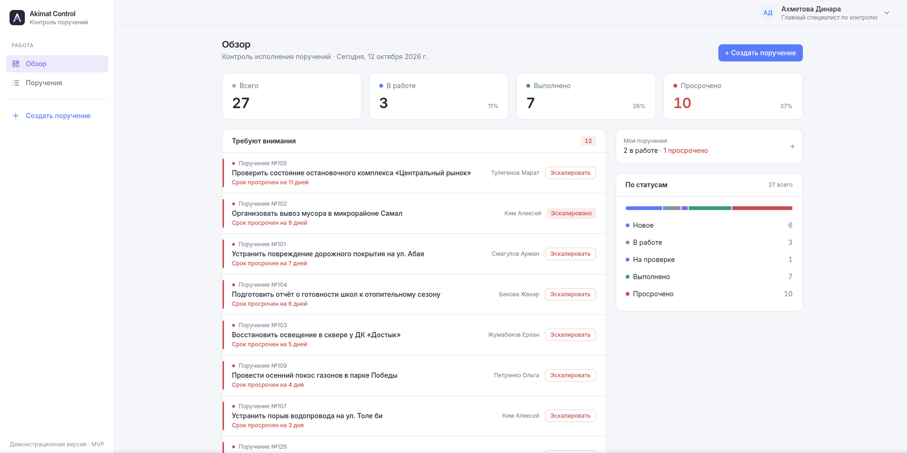
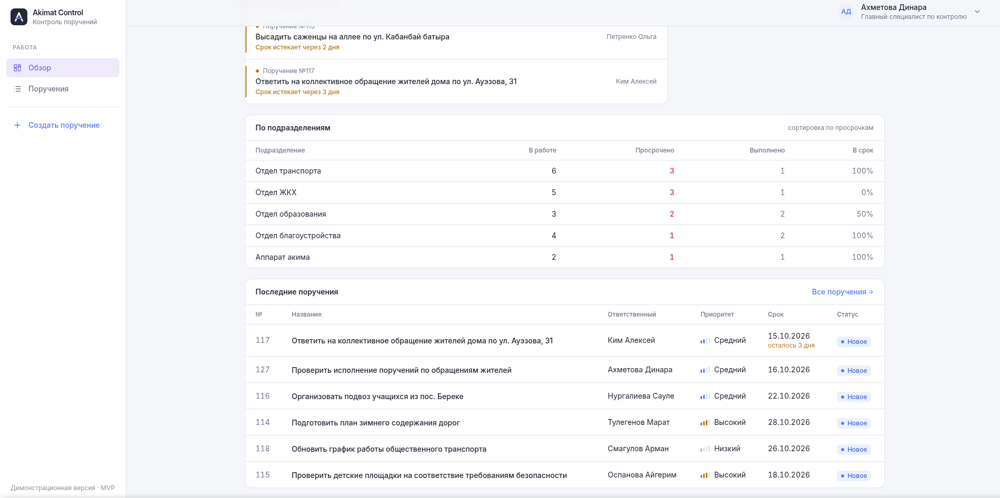
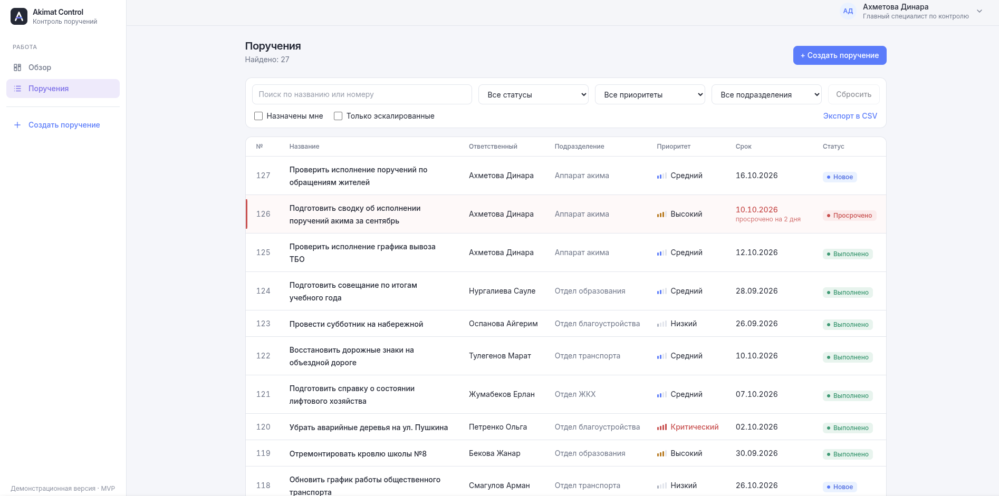
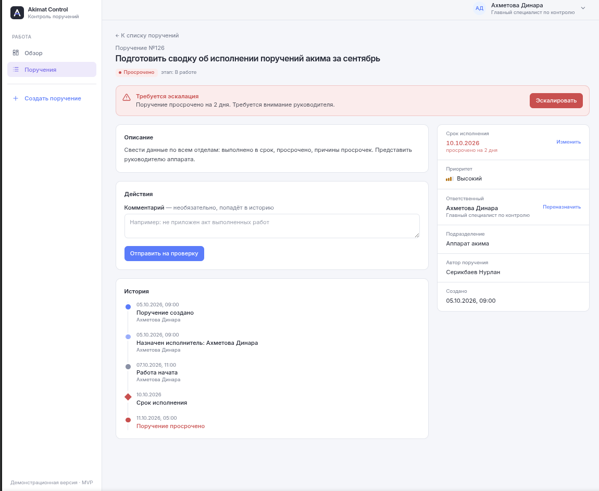
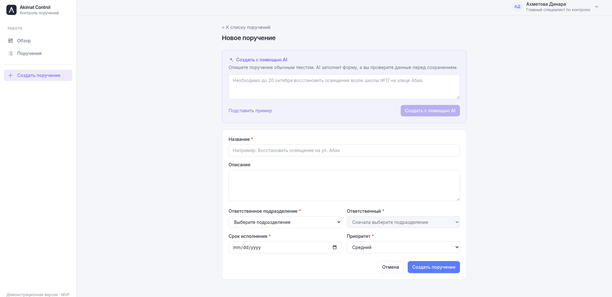
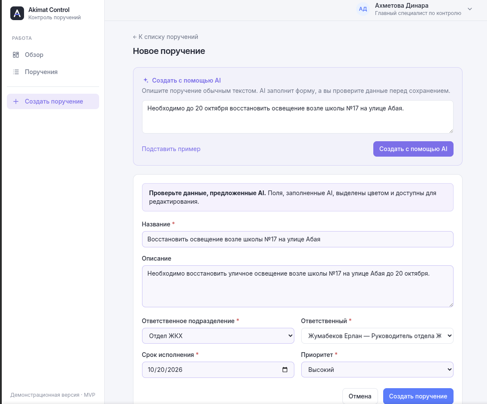
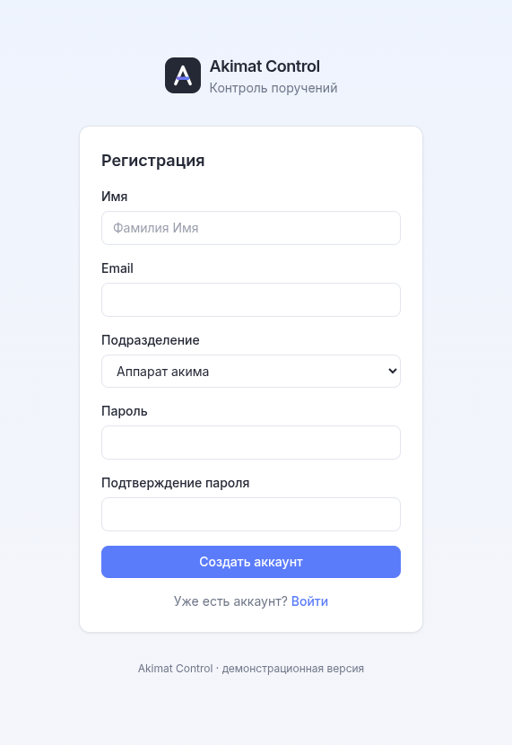
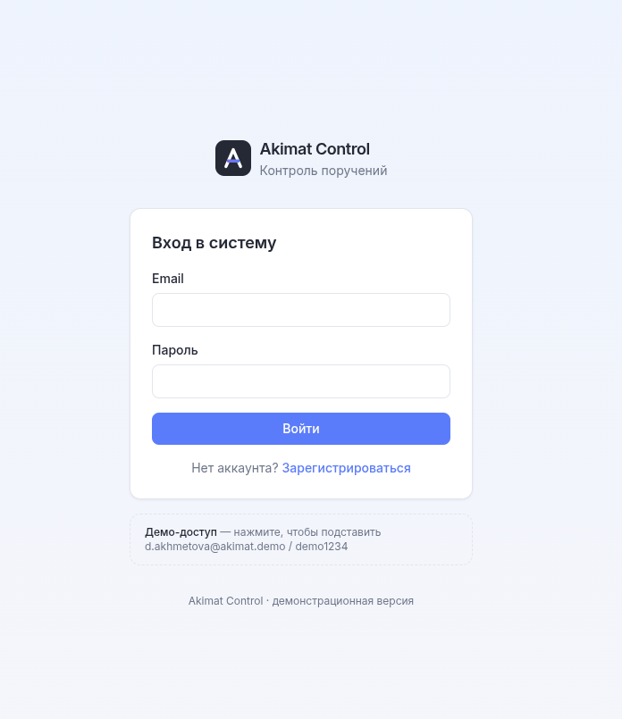

<div align="center">
  

  <h1>Akimat Control</h1>

  <h3>Интеллектуальная система контроля исполнения поручений</h3>

  <p>
    GovTech • Цифровизация государственного управления • AI
  </p>
</div>
  

**Akimat Control** — демонстрационный MVP веб-системы для цифровизации процессов постановки, исполнения и контроля поручений в государственных учреждениях.

Проект создан на основе ранее разработанного приложения для сотрудника компании — франчайзи «1С». Первоначальная версия использовалась для координации заявок между отделами. Для участия в конкурсе решение было переработано и адаптировано под задачи государственных учреждений.

Система объединяет поручения, подразделения, ответственных исполнителей, сроки и историю выполнения в едином информационном пространстве. Автоматический контроль сроков помогает своевременно выявлять просроченные поручения, а интеграция искусственного интеллекта упрощает их создание и обработку.

Таким образом, **Akimat Control** основан не только на идее, но и на опыте разработки решения для реальных рабочих процессов.

**Стадия:** Работающий MVP

**Технологии:** Nuxt 4, Vue 3, TypeScript, Prisma 7, SQLite, Tailwind CSS, Claude API

---

## Презентация проекта

Подготовлена презентация Akimat Control для конкурса стартап-проектов.

**[Скачать презентацию Akimat Control (PowerPoint)](docs/presentation/Akimat_Control_Startup.pptx)**

В презентации представлены проблема, предлагаемое решение, возможности MVP, применение искусственного интеллекта, архитектура, целевая аудитория и перспективы развития.

## Демонстрация интерфейса

### Панель управления





Главная страница предоставляет сводную информацию о поручениях, их статусах, сроках исполнения и подразделениях.

### Список поручений



Поиск, фильтрация, просмотр и экспорт поручений в CSV.

### Карточка поручения



Просмотр информации, изменение статуса, переназначение исполнителя, история действий и эскалация.

### Создание поручения с помощью AI





Интеллектуальное преобразование свободного текста в структурированный черновик поручения.

### Авторизация






Регистрация и вход пользователей в систему.

---

## 1. Актуальность и проблема

В государственных учреждениях поручения проходят через управления, районы, подразделения и организации.

При использовании разрозненных инструментов контроля возникают проблемы:

- Отсутствие единой картины исполнения поручений.
- Ручной контроль сроков.
- Несвоевременное выявление просрочек.
- Сложность отслеживания ответственных исполнителей.
- Дополнительные затраты времени на подготовку сводной информации.
- Недостаточная прозрачность истории выполнения поручений.

**Основная проблема:** руководителю необходимо оперативно понимать, какие поручения выполняются, какие просрочены и где требуется управленческое вмешательство.

## 2. Предлагаемое решение

Akimat Control предоставляет единый цифровой инструмент контроля исполнения поручений.

Основной процесс:

**Создание → Назначение → Исполнение → Проверка → Завершение**

Дополнительно система контролирует сроки, отображает предупреждения и позволяет эскалировать просроченные поручения.

Цель проекта — сделать процесс исполнения поручений более прозрачным, управляемым и удобным для руководителей и исполнителей.

## 3. Возможности MVP

### Управление поручениями

- Создание и редактирование поручений.
- Назначение ответственных исполнителей.
- Привязка поручений к подразделениям.
- Установка сроков и приоритетов.
- Поиск и фильтрация.
- Экспорт списка в CSV.

### Контроль исполнения

Поддерживаются этапы:

1. Новое.
2. В работе.
3. На проверке.
4. Выполнено.

Предусмотрен возврат на доработку с указанием причины.

### Мониторинг сроков

Система автоматически выявляет:

- Поручения с приближающимся сроком.
- Просроченные поручения.
- Поручения, требующие внимания руководства.

### Эскалация

При нарушении сроков пользователь может выполнить эскалацию с комментарием.

Информация об эскалации сохраняется в истории поручения.

### История действий

Система фиксирует основные события жизненного цикла поручения: создание, изменение статуса, переназначение, возврат на доработку и эскалацию.

### Пользователи

Реализованы регистрация, авторизация и пользовательские сессии.

## 4. Использование искусственного интеллекта

Одной из ключевых возможностей Akimat Control является создание поручений на естественном языке.

**Пример:**

> Необходимо до 20 октября восстановить освещение возле школы №17 на улице Абая.

После обработки система формирует черновик:

| Поле | Результат |
|---|---|
| Название | Восстановить освещение возле школы №17 |
| Описание | Восстановить освещение на улице Абая |
| Срок | 20 октября |
| Подразделение | Отдел ЖКХ |
| Приоритет | Высокий |

Для обработки используется Claude API.

Если API недоступен, система применяет резервный механизм обработки текста по ключевым словам и сообщает об этом пользователю.

**AI не сохраняет поручение автоматически.** Пользователь проверяет результат, при необходимости редактирует поля и подтверждает создание.

## 5. Целевая аудитория

Потенциальные пользователи системы:

- Аппараты акимов.
- Управления и отделы местных исполнительных органов.
- Государственные учреждения.
- Подведомственные организации.
- Руководители структурных подразделений.
- Специалисты по контролю исполнения поручений.

В перспективе система может адаптироваться для организаций, которым необходим централизованный контроль исполнения задач и поручений.

## 6. Преимущества

**Централизация.** Единая система хранения и обработки поручений.

**Прозрачность.** Возможность отслеживания статусов и истории исполнения.

**Оперативность.** Автоматическое выявление просрочек и приближающихся сроков.

**Удобство управления.** Информация о поручениях представлена на единой панели.

**Использование AI.** Упрощённое формирование поручений из свободного текста.

**Переносимость.** Демонстрационная версия использует SQLite и не требует отдельного сервера базы данных.

## 7. Технологический стек

| Технология | Назначение |
|---|---|
| Nuxt 4 | Fullstack веб-приложение |
| Vue 3 | Пользовательский интерфейс |
| TypeScript | Разработка приложения |
| Tailwind CSS | Стилизация |
| Prisma 7 | ORM и миграции |
| SQLite | База данных |
| Claude API | AI-обработка поручений |

Приложение реализовано как единый fullstack-проект.

## 8. Установка и запуск

### Требования

- Node.js 22.
- npm.
- Claude API Key (необязательно).

### Установка

Клонируйте репозиторий:

```bash
git clone <URL_РЕПОЗИТОРИЯ>
cd <ИМЯ_КАТАЛОГА>
```

Установите зависимости:

```bash
npm install
```

Создайте файл конфигурации:

```bash
cp .env.example .env
```

Для использования Claude API укажите в `.env`:

```env
ANTHROPIC_API_KEY=your_api_key
```

Подготовьте базу данных:

```bash
npm run db:setup
```

Запустите приложение:

```bash
npm run dev
```

Откройте:

http://localhost:3000

### Демонстрационные пользователи

| Email | Роль |
|---|---|
| d.akhmetova@akimat.demo | Главный специалист по контролю |
| n.serikbayev@akimat.demo | Руководитель аппарата |
| e.zhumabekov@akimat.demo | Руководитель отдела ЖКХ |
| a.kim@akimat.demo | Инженер ЖКХ |

**Пароль:** `demo1234`

Также доступна регистрация нового пользователя через `/register`.

Демонстрационные учётные записи не предназначены для публичного развёртывания.

### Сброс демонстрационных данных

```bash
npm run db:reset
```

Сроки демонстрационных поручений рассчитываются относительно текущей даты, поэтому после сброса доступны актуальные примеры просроченных и приближающихся поручений.

## 9. Демонстрационный сценарий

1. Авторизоваться в системе.
2. Просмотреть статистику на главной панели.
3. Открыть просроченное поручение.
4. Изучить историю выполнения.
5. Выполнить эскалацию.
6. Изменить статус другого поручения.
7. Вернуть поручение на доработку или завершить его.
8. Переназначить исполнителя.
9. Создать новое поручение через AI.
10. Проверить появление поручения в списке.
11. Экспортировать список поручений в CSV.

## 10. Архитектура проекта

```text
app/
    Страницы, компоненты, composables

server/api/
    REST API: поручения, dashboard,
    авторизация, AI

server/services/
    Бизнес-логика приложения

shared/
    Статусы, приоритеты, расчёт сроков

prisma/
    Схема базы данных, миграции, seed

docs/
    presentation/
    screenshots/
```

Статус «Просрочено» вычисляется по сроку исполнения при чтении данных. Основной этап исполнения при этом сохраняется. Событие просрочки фиксируется в истории один раз.

### Полезные команды

Просмотр базы:

```bash
npx prisma studio
```

Production-сборка:

```bash
npm run build
```

## 11. Ожидаемый эффект

Потенциальное внедрение Akimat Control направлено на:

- Сокращение времени поиска информации о поручениях.
- Снижение объёма ручного контроля.
- Своевременное выявление нарушений сроков.
- Повышение прозрачности исполнения.
- Упрощение подготовки оперативных сводок.
- Сокращение времени формирования поручений с помощью AI.

**Основной KPI:** доля поручений, исполненных в установленный срок.

Количественный эффект предполагается оценивать по результатам пилотного внедрения.

## 12. Перспективы развития

Следующие этапы развития продукта:

- Расширенная система ролей и прав доступа.
- Многоуровневое согласование поручений.
- Автоматическая эскалация по регламентам.
- Email, SMS и push-уведомления.
- Прикрепление документов.
- AI-аналитика причин просрочек.
- Автоматическая генерация отчётов.
- Интеграция с государственными информационными системами.
- Переход на серверную СУБД.
- Развёртывание в защищённой инфраструктуре.

Для промышленной эксплуатации потребуется дополнительная проработка информационной безопасности и нормативных требований.

## 13. О проекте

Akimat Control создан как работающий демонстрационный MVP для решения задачи цифровизации контроля поручений.

При разработке использовались инструменты AI-assisted development, позволившие ускорить реализацию приложения и сосредоточиться на пользовательских сценариях.

Проект демонстрирует возможность создания цифрового решения для проверки гипотезы и последующего пилотного внедрения.

---

**Akimat Control — от поручения до результата.**
